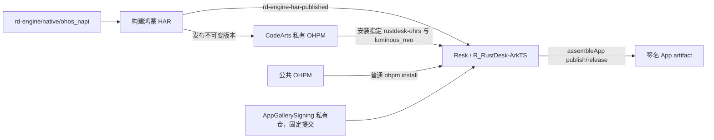

# rd-engine HAR → Resk GitHub Actions 链路

Resk 消费 rd-engine 直接产出的鸿蒙 HAR，再构建自己的 ArkTS App。
HAR 与 FRB 是同一引擎的两个平台出口，不存在独立 Core/Har 仓库。
默认只产出签名 App artifact，不上传或提交 AGC 测试版。



## ArkTS 构建流程

Resk workflow 接受 `rd-engine-har-published` dispatch，手动入口使用相同的
`package_name`、`package_version`、`engine_sha` 契约。以下为格式示例，不代表发布结果：

```json
{
  "package_name": "rustdesk-ohrs",
  "package_version": "0.1.0-ci.4.1.g99d3ad29",
  "engine_sha": "99d3ad29657a3f7f7370fd66e88180f7461fb48b"
}
```

构建步骤固定为：

1. Checkout ArkTS，校验精确包版本和完整 40 位 rd-engine SHA，再安装 Java 17 与 HarmonyOS 命令行工具。普通 push 必须配置仓库 Variables `RD_ENGINE_HAR_VERSION`、`RD_ENGINE_SHA`；dispatch/手动运行缺字段时失败，不回退到 push 的 Variables。
2. 从 CodeArts 安装指定 `rustdesk-ohrs@<version>` 和 `luminous_neo@1.0.2`。只从 Secret 提取该私仓作用域的只读认证，临时配置权限为 `0600`，固定 `strict_ssl=true`，不继承全局私仓地址或关闭 TLS 的配置。认证安装日志不回显或上传；退出 trap 和 workflow 的 `always()` 清理都会删除临时认证与日志。
3. 删除私仓认证后，在根目录和 `entry` 执行普通 `ohpm install`；不更改普通公共依赖的版本、共享缓存配置或已提交的开发依赖/锁文件。精确 HAR 版本只写入本次 runner 的工作副本。
4. 使用 `scripts/verify-native-har.py --installed` 校验最终安装内容：`provenance_version=2`、`kind=har`、固定仓库 `https://github.com/FrankHan052176/rd-engine`、精确 `engine_sha`、`source_dirty=false`、包名/版本、OHOS target 和包元数据必须匹配；`librd_engine_native_har.so`、`libc++_shared.so` 必须是 AArch64 shared ELF，且 SHA-256 与嵌入来源一致。记录 OHPM lock 中的包 integrity，不使用旧 `source_state`、build receipt 或旧库名。
5. Checkout 签名仓的固定提交，调用 `.github/scripts/prepare-signing-config.sh` 准备签名，再执行：

   ```shell
   hvigorw assembleApp -p product=publish -p buildMode=release
   ```

6. 上传 `RustDesk-${完整 HAR 版本}.app`、`har-provenance.json` 与 App 的 `release-provenance.json`，包含 ArkTS/rd-engine SHA、签名仓精确 SHA、HAR 版本/integrity/原生库哈希、App 动态版本、App/HAP SHA-256 和 CI run 标识。

OHPM 安装不提供生产者旁置的 archive sidecar，因此 installed 检查不宣称验证了 HAR
压缩档哈希或 sidecar；来源记录注明 `verification_scope=installed-package-static`。
包的静态校验通过也不等于当前 Resk 的 NAPI ABI 已对齐，或模块能在设备上加载。
真实 HAR 消费、ArkTS 编译、设备运行须分别取得本次结果，不拿旧构建或来源字段替代。
本 workflow 不修改或发布引擎仓库。

## 本地刷新

先在 `rd-engine` 执行 `bash native/ohos_napi/build-har.sh`，再从 Resk 执行：

```shell
bash scripts/refresh-native-har.sh
# Windows PowerShell：
# ./scripts/refresh-native-har.ps1
```

默认读取 `../rd-engine/native/ohos_napi/target/package.har` 及其相邻的
`release-provenance.json`，不调用 Cargo metadata 猜包位置，也不从其他产品取内核。
可用 `RD_ENGINE_ROOT` 指定引擎根目录，或用 `NATIVE_HAR_PATH`、`NATIVE_PROVENANCE_PATH`
显式选择真实档案及 sidecar；PowerShell 对应 `-EngineRoot`、`-SourceHar`。
可设置 `RD_ENGINE_SHA`、`RD_ENGINE_HAR_VERSION` 额外要求精确来源（SHA 使用小写）。

刷新先检查档案成员：仅接受 `package/` 内规范路径的普通文件/目录，拒绝重复成员、
路径穿越、链接和特殊文件；校验元数据、两库 ELF/哈希以及嵌入来源与真实 sidecar
逐字段一致，sidecar 的 `har_sha256` 必须等于档案字节哈希，然后才复制并重新安装。
开发包允许 `source_dirty=true`，会明确报告；CI 的 `--require-clean` 拒绝它。
Schema 2 不含工作树 freshness receipt；本地脚本不声称证明档案等同当前未提交源码。
原有 `CORE_ROOT`、`OHOS_NAPI_OUT_DIR`、`NATIVE_HAR_ALLOW_STALE` 和 PowerShell
`-CoreRoot`/`-AllowStale` 不再适用，请改用上述 rd-engine 路径/来源参数。

## GitHub 配置

workflow 使用 `harmonyos-ci-signing` Environment。

| 类型 | 名称 | 用途 |
|---|---|---|
| Secret | `CODEARTS_PRIVATE_OHPM_READ` | CodeArts 私仓只读认证配置 |
| Secret | `SIGNING_REPOSITORY_TOKEN` | 读取签名私仓 |
| Variable | `SIGNING_REPOSITORY` | 可选，默认 `FrankHan052176/AppGallerySigning` |
| Variable | `SIGNING_REPOSITORY_REF` | 可选，必须为完整 40 位提交；默认 `70779bd9e42c8565772dd8c43c80b89a197c3369` |
| Variable | `RD_ENGINE_HAR_VERSION` | push 构建必需：已发布的精确 rd-engine HAR 版本 |
| Variable | `RD_ENGINE_SHA` | push 构建必需：对应的完整 40 位 rd-engine 提交 |

`CODEARTS_PRIVATE_OHPM_READ` 保存私仓认证片段，例如：

```ini
//devrepo.devcloud.cn-north-4.huaweicloud.com/artgalaxy/api/ohpm/cn-north-4_c07b1b38744f424b8d87a86532d38003_ohpm_1/:_read_auth=REPLACE_WITH_READ_ONLY_TOKEN
strict_ssl=true
```

不要把真实 Token 或 `.ohpmrc` 提交到仓库。

## AGC 测试发布

AGC 测试发布默认关闭。仅手动 `workflow_dispatch` 显式设置 `publish_test=true`，且
`AGC_CLIENT_ID`、`AGC_CLIENT_SECRET`、`AGC_APP_ID` 三个 Secret 齐全时，才调用
`.github/scripts/agc-test-release.sh` 上传并提交邀请测试版本。push、repository_dispatch
及默认手动运行均只构建 artifact；dispatch payload 中即使传 `publish_test=true` 也无效。
测试固定使用 `testType=3` 与 `onshelfSelfDetect=0`，会收集所有测试群组；无群组时失败
而不会提交空测试版本。可选变量 `AGC_TEST_DURATION_DAYS` 默认 14 天。
