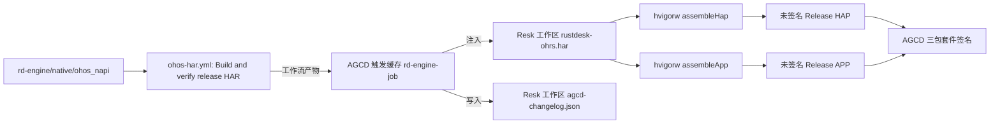

# rd-engine HAR → Resk 本地 Release 链路

Resk 消费 rd-engine 直接产出的鸿蒙 HAR，再构建自己的 ArkTS App。
HAR 与 FRB 是同一引擎的两个平台出口，不存在独立 Core/Har 仓库。

rd-engine 的 HAR 依赖私有 OHPM，签名材料只在本机存在，因此 Release 包由本机 AGCD
构建并签名；`.github/workflows/` 只做无密钥的仓库检查，不构建、不签名、不发布。



## 注入契约

| 项目 | 值 |
|---|---|
| AGCD projectId | `rustdesk-resk` |
| 触发 | `triggerId: rd-engine-job`，仓库 `FrankHan052176/rd-engine`，`ohos-har.yml` 的 `Build and verify release HAR` |
| HAR 注入路径 | `injectTargetRelPath: rustdesk-ohrs.har`（仓库根） |
| 变更日志 | 仓库根 `agcd-changelog.json` |

`rustdesk-ohrs.har`（由 `*.har` 规则）与 `agcd-changelog.json` 都是本地产物，已被
`.gitignore` 忽略，不进入仓库。变更日志携带 `versionName`、`versionCode`，以及分类后的
`mainProject: { sourceName, repo, version, summary, items[] }` 与
`upstreams: [{ triggerId, sourceName, repo, version, summary, items[] }]`。

## 构建期注入

根 `hvigorfile.ts` 在 Hvigor 求值项目时完成两件事，两者都不改写受版本控制的文件：

1. **HAR 同步**：`ohpm` 只会在安装时展开一次 `file:./rustdesk-ohrs.har` 依赖，AGCD 就地
   替换 HAR 后已安装的包仍是旧引擎。构建开始前比较 `rustdesk-ohrs.har` 的 SHA-256 与
   `oh_modules/.rustdesk-ohrs-har.sha256`；不一致时把档案解到 `oh_modules/.rustdesk-ohrs-sync`，
   清空 `oh_modules/rustdesk-ohrs`（`ohpm` 建立的链接）指向的真实目录后写入新内容，并更新
   stamp。摘要一致时直接跳过，因此本地开发不需要 `ohpm` 重装，也不会重复解包。
   同步失败会终止构建，避免把旧引擎打进 Release 包。
2. **版本注入**：存在 `agcd-changelog.json` 时，用 `appContext.setAppJsonOpt` 注入其中的
   `versionName` 与 `versionCode`，`AppScope/app.json5` 保持本地基线不变；文件不存在时
   构建照常使用 `AppScope/app.json5` 的版本。文件存在但缺少有效的 `versionName`/`versionCode`
   时构建失败，而不是悄悄用旧版本号出包。

本地签名仍由 `RUSTDESK_SIGNING_DIR` 注入 `signingConfigs.json`；未签名构建
（`-p enableSignTask=false`）不读取它，也不加载任何签名材料。

## 本地 Release 构建

`build-profile.json5` 的 App products 是 `default` 与 `publish`，`buildMode` 是 `debug` 与
`release`。未签名 Release 产物由下面两条命令生成（AGCD 使用同一组命令）：

```shell
ohpm install && (cd entry && ohpm install)
hvigorw assembleHap --no-daemon -p buildMode=release -p enableSignTask=false
hvigorw assembleApp --no-daemon -p product=publish -p buildMode=release -p enableSignTask=false
```

| 产物 | 路径 |
|---|---|
| 未签名 Release HAP | `entry/build/default/outputs/default/entry-default-unsigned.hap` |
| 未签名 Release APP | `build/outputs/publish/<工程目录名>-publish-unsigned.app` |

`pack.info`（HAP 目录内与 APP 包内各一份）的 `summary.app.version` 反映生效的版本，
即 AGCD 注入的 `versionName`/`versionCode`，或本地基线。

## GitHub CI

`.github/workflows/verify.yml` 只在 push / pull_request / workflow_dispatch 上做无密钥检查：
解析 workflow YAML、`bash -n` 全部 shell 脚本、编译 `scripts/verify-native-har.py`，并确认
`agcd-changelog.json` 与 `rustdesk-ohrs.har` 未被跟踪、签名材料与 `.hap`/`.app` 等产物不在
版本控制内。它不使用任何 Secret、不下载私有依赖、不上传产物、不推送 AGC。未签名 Release
编译校验需要私有 HAR 与 `luminous_neo`，因此只在本机通过 AGCD 执行。

## 本地刷新

先在 `rd-engine` 执行 `bash native/ohos_napi/build-har.sh`，再从 Resk 执行：

```shell
bash scripts/refresh-native-har.sh
# Windows PowerShell：
# ./scripts/refresh-native-har.ps1
```

默认读取 `../rd-engine/native/ohos_napi/target/package.har` 及其相邻的
`release-provenance.json`，不调用 Cargo metadata 猜包位置，也不从其他产品取内核。
可用 `RD_ENGINE_ROOT` 指定引擎根目录，或用 `NATIVE_HAR_PATH`、`NATIVE_PROVENANCE_PATH`
显式选择真实档案及 sidecar；PowerShell 对应 `-EngineRoot`、`-SourceHar`。
可设置 `RD_ENGINE_SHA`、`RD_ENGINE_HAR_VERSION` 额外要求精确来源（SHA 使用小写）。

刷新先检查档案成员：仅接受 `package/` 内规范路径的普通文件/目录，拒绝重复成员、
路径穿越、链接和特殊文件；校验元数据、两库 ELF/哈希以及嵌入来源与真实 sidecar
逐字段一致，sidecar 的 `har_sha256` 必须等于档案字节哈希，然后才复制并重新安装。
开发包允许 `source_dirty=true`，会明确报告；CI 的 `--require-clean` 拒绝它。
Schema 2 不含工作树 freshness receipt；本地脚本不声称证明档案等同当前未提交源码。
原有 `CORE_ROOT`、`OHOS_NAPI_OUT_DIR`、`NATIVE_HAR_ALLOW_STALE` 和 PowerShell
`-CoreRoot`/`-AllowStale` 不再适用，请改用上述 rd-engine 路径/来源参数。
